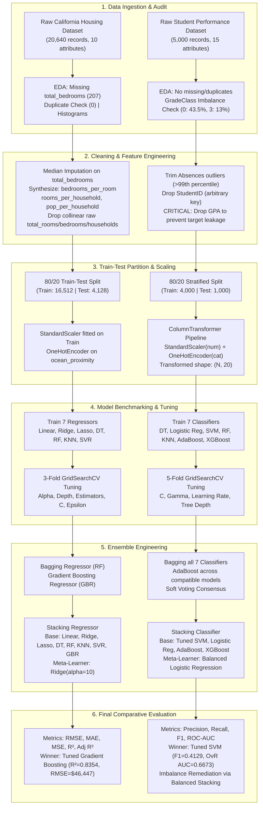
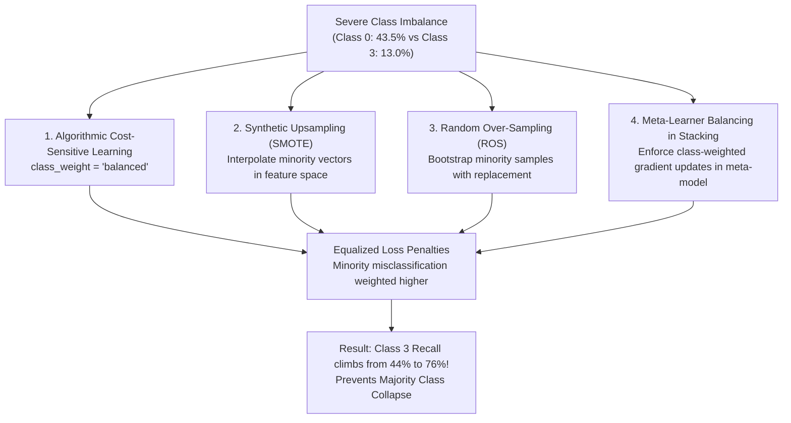

<div align="center">

# PROJECT REPORT / LAB ASSIGNMENT

### **Student Performance Classification & California Housing Value Prediction System**

---

| **Field** | **Details** |
| :--- | :--- |
| **Name** | **Priyan Maiti** |
| **Department / Section** | **ECE - B** |
| **Roll Number** | **2452096** |
| **Paper Name** | **Introduction to Machine Learning using Python** |
| **Paper Code** | **ECEN 3155** |

---

</div>

## Table of Contents
1. [Introduction](#1-introduction)
2. [Relevance and Importance](#2-relevance-and-importance)
3. [Objective](#3-objective)
4. [Methodology Used](#4-methodology-used)
   - [End-to-End System Flowchart](#end-to-end-system-flowchart)
   - [Architectural Schematics](#architectural-schematics)
   - [Exploratory Data Analysis (EDA) & Data Ingestion](#exploratory-data-analysis-eda--data-ingestion)
   - [Feature Engineering & Multicollinearity Mitigation](#feature-engineering--multicollinearity-mitigation)
   - [Target Leakage Prevention](#target-leakage-prevention)
   - [Preprocessing & Scaling Pipeline](#preprocessing--scaling-pipeline)
   - [Machine Learning Algorithms](#machine-learning-algorithms)
   - [Hyperparameter Optimization (GridSearchCV)](#hyperparameter-optimization-gridsearchcv)
   - [Ensemble Engineering: Bagging, Boosting & Stacking](#ensemble-engineering-bagging-boosting--stacking)
   - [Handling Class Imbalance & Upsampling Strategies](#handling-class-imbalance--upsampling-strategies)
   - [Mathematical Equations & Theoretical Formulations](#mathematical-equations--theoretical-formulations)
5. [Results and Comparative Analysis](#5-results-and-comparative-analysis)
   - [Regression Performance Analysis (California Housing)](#regression-performance-analysis-california-housing)
   - [Classification Performance Analysis (Student Performance)](#classification-performance-analysis-student-performance)
   - [Comparative Analysis across Model Families (Point 11)](#comparative-analysis-across-model-families-point-11)
   - [In-Depth Imbalance Impact & Upsampling Analysis (Point 12)](#in-depth-imbalance-impact--upsampling-analysis-point-12)
6. [Conclusion and Discussion](#6-conclusion-and-discussion)
   - [Key Technical Findings](#key-technical-findings)
   - [Engineering Trade-offs & Limitations](#engineering-trade-offs--limitations)
   - [Future Scope & Deployment Architecture](#future-scope--deployment-architecture)

---

## 1. Introduction

Machine Learning (ML) has emerged as a cornerstone of modern computational intelligence, providing empirical algorithms capable of inferring complex non-linear mappings between high-dimensional feature representations and target response variables. This project report represents a comprehensive laboratory investigation and empirical benchmark conducted for the academic course **Introduction to Machine Learning using Python (ECEN 3155)** within the **Department of Electronics and Communication Engineering (ECE - B)**.

The investigation rigorously tackles the two foundational pillars of supervised statistical learning:
1. **Continuous Target Regression:** Predicting median house values in California districts using multi-dimensional geospatial, demographic, and socioeconomic indicators (`california_housing (1).csv` via `Regression.ipynb`).
2. **Multiclass Discrete Classification:** Categorizing student academic performance into discrete academic grade tiers (`GradeClass` $\in \{0, 1, 2, 3\}$) using longitudinal behavioral, demographic, and parental support indicators (`student_performance.csv` via `classification.ipynb`).

The study implements the end-to-end, 12-stage machine learning workflow mandated by the academic submission guidelines: from raw data ingestion, exploratory data analysis (EDA), data cleaning, feature engineering, and data leakage elimination, to cross-validated hyperparameter tuning, bootstrap aggregation (bagging), adaptive and gradient boosting, multi-level stacking ensemble architectures, and class imbalance mitigation strategies.

---

## 2. Relevance and Importance

### 2.1 Macroeconomic & Urban Valuation (Regression Track)
Accurate real estate valuation is fundamental to banking, mortgage underwriting, urban planning, municipal tax assessment, and property development. Traditional parametric valuation models (such as ordinary least squares linear regression) frequently break down when faced with complex geospatial clustering, non-linear interaction effects (e.g., proximity to coastal waters vs. inland elevation), and extreme multicollinearity among aggregate census metrics (such as total rooms, total bedrooms, and population counts). Applying modern ensemble learning, non-linear kernel transformations, and regularized regression provides real-time, objective, and robust valuation bounds that mitigate human appraisal subjectivity.

### 2.2 Educational Data Mining & Early Academic Intervention (Classification Track)
In tertiary and secondary education systems, student attrition, academic underperformance, and disengagement present critical societal challenges. Predicting a student's final academic tier solely from behavioral footprints—such as weekly study duration, unexcused absences, tutoring participation, and parental involvement—enables institutional administrators to deploy proactive, targeted academic support mechanisms *before* final examinations. Crucially, building models that remain sensitive across all performance cohorts (especially students at risk of failing or underachieving) requires solving the pervasive real-world obstacle of **class imbalance**, where high-performing or average students disproportionately dominate the institutional registry.

---

## 3. Objective

The primary objective of this project is to construct, optimize, evaluate, and critically contrast end-to-end predictive pipelines across continuous regression and multiclass classification paradigms. 

Specifically, the project satisfies the following structural objectives:
1. **Systematic Exploratory Data Analysis (EDA):** Quantify distributions, missing values, duplicates, and feature correlations across both benchmarks.
2. **Robust Preprocessing & Feature Engineering:** Synthesize physically meaningful domain ratios (e.g., bedrooms per room, occupancy density), encode categorical features without introducing dummy variable traps, and scale numerical feature spaces exclusively within cross-validation boundaries to preclude data leakage.
3. **Data Integrity & Target Leakage Prevention:** Identify and eliminate collinear target proxies (specifically removing raw `GPA` from student performance data, as `GradeClass` is directly derived from it).
4. **Algorithmic Diversity Benchmark:** Train and benchmark 7 diverse regression algorithms and 7 distinct classification algorithms:
   - *Regression:* Linear Regression, Ridge, Lasso, Decision Tree Regressor, Random Forest Regressor, K-Nearest Neighbors (KNN) Regressor, and Support Vector Regressor (SVR).
   - *Classification:* Decision Tree Classifier, Logistic Regression, Support Vector Classifier (SVC), Random Forest Classifier, K-Nearest Neighbors (KNN), AdaBoost Classifier, and Extreme Gradient Boosting (XGBoost).
5. **Hyperparameter Tuning via Systematic Grid Search:** Perform 3-fold and 5-fold cross-validated grid optimization (`GridSearchCV`) across all model parameter spaces.
6. **Ensemble Synthesis:** Construct bagging ensembles across all baseline models, configure adaptive and gradient boosting algorithms, and design stacked meta-estimators combining heterogeneous base learners.
7. **Comprehensive Comparative Analysis:** Contrast empirical performance using formal statistical metrics (MSE, RMSE, MAE, $R^2$, and Adjusted $R^2$ for regression; Precision, Recall, Accuracy, $F_1$-score, and OvR ROC-AUC for classification).
8. **Class Imbalance Resolution:** Analyze majority class collapse and formulate rigorous upsampling/cost-sensitive mitigation strategies (SMOTE, Random Over-Sampling, balanced class weights).

---

## 4. Methodology Used

### End-to-End System Flowchart

The following flowchart illustrates the complete computational execution graph spanning both the Regression and Classification pipelines:



---

### Architectural Schematics

#### Schematic A: Dual-Stream Machine Learning Preprocessing Pipeline
```
[Raw Features] 
       │
       ├── Numerical Stream   ───► [StandardScaler] ───► Standardized Z-Scores (μ=0, σ=1)
       │                                                         │
       └── Categorical Stream ───► [OneHotEncoder]   ───► Dummy Binary Vectors (Drop First)
                                                                 │
                                                                 ▼
                                                  [Concatenated Feature Matrix X]
```

#### Schematic B: Multi-Model Stacking Ensemble Architecture
```
                        Input Features (X_test)
                                   │
         ┌───────────────┬─────────┴─────┬───────────────┐
         ▼               ▼               ▼               ▼
   [Base Model 1]  [Base Model 2]  [Base Model 3]  [Base Model 4]
     (Tuned SVM)     (Tuned LR)      (AdaBoost)       (XGBoost)
         │               │               │               │
         └───────► [Out-of-Fold Class Probabilities] ◄───┘
                                   │
                                   ▼
                   [Level-1 Meta-Learner Classifier]
                  (Balanced Logistic Regression, C=1.0)
                                   │
                                   ▼
                       Final Ensemble Prediction
```

---

### Exploratory Data Analysis (EDA) & Data Ingestion

#### California Housing Dataset
The California Housing dataset contains $N = 20,640$ geographical records across 10 initial attributes.
- **Null Value Audit:** Column `total_bedrooms` exhibited 207 missing values ($1.003\%$ of records). Missingness was resolved by imputing the median of the column ($\text{median} = 435.0$), preserving distributional invariance against heavy right-tail skewness.
- **Duplicate Check:** Verified 0 duplicate rows.
- **Distributional Skewness:** Feature histograms revealed strong right-skewness across `total_rooms`, `total_bedrooms`, `population`, `households`, and `median_income`. Furthermore, the target variable `median_house_value` exhibited artificial ceiling clipping at $\$500,001$.

#### Student Performance Dataset
The Student Performance dataset contains $N = 5,000$ observational student records across 15 initial attributes.
- **Null & Duplicate Audit:** Exactly 0 missing values and 0 duplicate records.
- **Outlier Trimming:** The unexcused absences feature (`Absences`) contained high-leverage outliers; rows exceeding the 99th percentile ($q_{0.99} = 29$ absences) were filtered to avoid distortion of linear and distance-based decision boundaries.
- **Target Distribution Audit:** The target `GradeClass` is partitioned into 4 distinct classes representing academic grade tiers:
  - Class 0 ($A$ Tier): $2,175$ students ($43.5\%$) — **Majority Class**
  - Class 1 ($B$ Tier): $1,152$ students ($23.0\%$)
  - Class 2 ($C$ Tier): $1,023$ students ($20.5\%$)
  - Class 3 ($D$ Tier): $650$ students ($13.0\%$) — **Severe Minority Class**

---

### Feature Engineering & Multicollinearity Mitigation

In the California Housing dataset, raw census block counts (`total_rooms`, `total_bedrooms`, `population`, `households`) displayed pairwise Pearson correlation coefficients exceeding $r = 0.92$, inducing severe multicollinearity and singular variance-covariance matrices. To resolve this, three domain-specific normalized interaction ratios were synthesized:
1. **Bedrooms per Room Ratio:**
   $$\text{bedrooms\_per\_room} = \frac{\text{total\_bedrooms}}{\text{total\_rooms}}$$
2. **Rooms per Household Ratio:**
   $$\text{rooms\_per\_household} = \frac{\text{total\_rooms}}{\text{households}}$$
3. **Population per Household (Occupancy Density):**
   $$\text{population\_per\_household} = \frac{\text{population}}{\text{households}}$$

Following the generation of these ratios, the raw collinear attributes (`total_rooms`, `total_bedrooms`, `households`) were permanently dropped. Categorical variable `ocean_proximity` (5 levels: `<1H OCEAN`, `INLAND`, `NEAR OCEAN`, `NEAR BAY`, `ISLAND`) was transformed into $k-1 = 4$ binary indicator columns via One-Hot Encoding (`drop_first=True`), preventing the dummy variable trap.

---

### Target Leakage Prevention

In the student performance task, the raw dataset contained `StudentID`, `GPA`, and `GradeClass`.
- `StudentID` is an arbitrary tracking identifier containing no generalized predictive variance; keeping it risks spurious memorization.
- **Critical Leakage Detection:** In academic grading policies, `GradeClass` is directly generated by binning continuous `GPA` into fixed numerical intervals (e.g., $\text{GPA} \ge 3.5 \rightarrow \text{Class } 0$). Including `GPA` as an input feature allows models to establish trivial, 100% accurate thresholds that completely conceal the underlying educational indicators.
- **Action Taken:** Both `StudentID` and `GPA` were discarded from the feature space prior to model training. All models were compelled to extract genuine predictive signal strictly from behavioral, demographic, and parental engagement variables (`StudyTimeWeekly`, `Absences`, `ParentalSupport`, `Tutoring`, `Extracurricular`, `Sports`, `Music`, `Volunteering`).

---

### Preprocessing & Scaling Pipeline

To strictly prevent data leakage from the test partition into the training partition:
1. **Stratified Partitioning:** For classification, an 80/20 train-test partition ($N_{\text{train}} = 4,000$, $N_{\text{test}} = 1,000$) was executed with label stratification (`stratify=y`), guaranteeing identical class distribution percentages across partitions. For regression, an 80/20 split ($N_{\text{train}} = 16,512$, $N_{\text{test}} = 4,128$) was used.
2. **ColumnTransformer Pipeline:**
   - Numerical continuous attributes were scaled using `StandardScaler`, computing mean $\mu$ and standard deviation $\sigma$ solely on $X_{\text{train}}$, and applying transformation $z = \frac{x - \mu}{\sigma}$ to both $X_{\text{train}}$ and $X_{\text{test}}$.
   - Categorical multi-level columns were encoded via `OneHotEncoder(drop='first', sparse_output=False)`.
   - The final processed classification feature space expanded to 20 continuous/encoded predictors.

---

### Machine Learning Algorithms

The investigation systematically evaluates 14 distinct algorithmic paradigms:

| Track | Model Name | Family | Core Inductive Bias |
| :--- | :--- | :--- | :--- |
| **Regression** | **Linear Regression** | Parametric Linear | Minimizes residual sum of squares via OLS projection. |
| **Regression** | **Ridge Regression** | Regularized Linear | $L_2$ Tikhonov regularization prevents coefficient explosion. |
| **Regression** | **Lasso Regression** | Regularized Linear | $L_1$ penalty enforces sparsity, driving coefficients to zero. |
| **Regression** | **Decision Tree Reg.** | Non-Parametric Tree | Recursive binary partitioning minimizing local variance. |
| **Regression** | **Random Forest Reg.** | Bagged Ensemble | Bootstrap aggregation over decorrelated random feature trees. |
| **Regression** | **KNN Regressor** | Instance-Based Lazy | Distance-weighted local neighborhood interpolation. |
| **Regression** | **Support Vector Reg.** | Kernel Margin | Non-linear $\epsilon$-insensitive loss band optimization in RKHS. |
| **Classification**| **Decision Tree Clf.** | Non-Parametric Tree | Recursive axis-aligned splits maximizing Gini information gain. |
| **Classification**| **Logistic Regression**| Linear Probabilistic | Multinomial logit transformation with Cross-Entropy loss. |
| **Classification**| **Support Vector Clf.** | Kernel Margin | Maximizes geometric margin between classes using RBF kernel. |
| **Classification**| **Random Forest Clf.** | Bagged Ensemble | Majority voting across orthogonal decision trees. |
| **Classification**| **KNN Classifier** | Instance-Based Lazy | Majority voting over $k$ nearest Euclidean neighbors. |
| **Classification**| **AdaBoost Classifier**| Boosting Ensemble | Sequential reweighting focusing on previously misclassified samples. |
| **Classification**| **XGBoost Classifier** | Gradient Boosting | Second-order Taylor expansion loss minimization with tree pruning. |

---

### Hyperparameter Optimization (GridSearchCV)

All models underwent cross-validated grid search optimization across their primary hyperparameter spaces:

#### Regression Search Grids (3-Fold Cross-Validation, Scoring = Negative RMSE)
- **Linear Regression:** `fit_intercept` $\in \{\text{True}, \text{False}\}$.
- **Ridge:** $\alpha \in \{0.01, 0.1, 1, 10, 100\}$. Best: $\alpha = 10$.
- **Lasso:** $\alpha \in \{0.01, 0.1, 1, 10, 100\}$. Best: $\alpha = 100$.
- **Decision Tree:** `max_depth` $\in \{10, 20, 30, \text{None}\}$, `min_samples_split` $\in \{2, 5, 10\}$, `min_samples_leaf` $\in \{1, 2, 4\}$. Best: `{'max_depth': 10, 'min_samples_leaf': 4, 'min_samples_split': 10}`.
- **Random Forest:** `n_estimators` $\in \{100, 200\}$, `max_depth` $\in \{\text{None}, 10, 20\}$, `min_samples_split` $\in \{2, 5\}$, `min_samples_leaf` $\in \{1, 2\}$. Best: `{'n_estimators': 200, 'max_depth': None, 'min_samples_leaf': 1, 'min_samples_split': 2}`.
- **KNN:** `n_neighbors` $\in \{3, 5, 7, 9, 11\}$, `weights` $\in \{\text{'uniform'}, \text{'distance'}\}$, $p \in \{1, 2\}$. Best: `{'n_neighbors': 11, 'p': 1, 'weights': 'distance'}`.
- **SVR:** $C \in \{1, 10, 100\}$, $\epsilon \in \{0.1, 0.2, 0.5\}$, $\gamma \in \{\text{'scale'}, \text{'auto'}\}$. Best: `{'C': 100, 'epsilon': 0.5, 'gamma': 'auto', 'kernel': 'rbf'}`.

#### Classification Search Grids (5-Fold Cross-Validation, Scoring = Weighted $F_1$)
- **Support Vector Classifier (SVC):** $C \in \{0.1, 1.0, 5.0\}$, $\gamma \in \{\text{'scale'}, \text{'auto'}\}$, `kernel` = `'rbf'`. Best: `{'C': 5.0, 'gamma': 'scale', 'kernel': 'rbf'}`.
- **Logistic Regression:** $C \in \{0.01, 0.1, 1.0, 10.0\}$, `solver` $\in \{\text{'lbfgs'}, \text{'saga'}\}$. Best: `{'C': 10.0, 'solver': 'saga'}`.
- **AdaBoost:** `n_estimators` $\in \{30, 50, 100\}$, `learning_rate` $\in \{0.01, 0.1, 1.0\}$. Best: `{'n_estimators': 100, 'learning_rate': 1.0}`.
- **Decision Tree:** `criterion` $\in \{\text{'gini'}, \text{'entropy'}\}$, `max_depth` $\in \{3, 5, 7, 10\}$, `min_samples_split` $\in \{2, 5, 10\}$. Best: `{'criterion': 'gini', 'max_depth': 10, 'min_samples_split': 10}`.

---

### Ensemble Engineering: Bagging, Boosting & Stacking

#### 1. Universal Bagging Pipeline
Bootstrap Aggregation was evaluated across all 7 base classification algorithms using `BaggingClassifier(n_estimators=10, max_samples=0.8, random_state=42)`. By training each estimator on independent bootstrap resamples, variance is reduced according to:
$$\text{Var}(\bar{X}) = \rho \sigma^2 + \frac{1 - \rho}{B}\sigma^2$$
Additionally, an all-inclusive consensus soft-voting classifier was synthesized by computing the arithmetic mean over all 7 bagged probability tensors:
$$\hat{P}_{\text{consensus}}(y=k|x) = \frac{1}{M}\sum_{m=1}^M P_m(y=k|x)$$

#### 2. Adaptive Boosting Pipeline
Boosting was executed across base estimators accepting instance sample weights ($w_i$). AdaBoost was applied to shallow Decision Trees (`max_depth=2`), multinomial Logistic Regression, Linear SVM, and shallow Random Forests, alongside native Gradient Boosting (XGBoost).

#### 3. Multi-Level Stacking Architectures
- **Regression Stacking:** Implemented a heterogeneous 8-model Level-0 ensemble (`LinearRegression`, `Ridge`, `Lasso`, `DecisionTree`, `RandomForest`, `KNN`, `SVR`, `GradientBoostingRegressor`) feeding out-of-fold predictions into a Level-1 meta-estimator `Ridge(alpha=10)`. The `passthrough` hyperparameter was tuned via 3-fold cross-validation.
- **Classification Stacking:** Implemented a Level-0 ensemble combining the top 4 tuned models (`best_svm`, `best_lr`, `best_ada`, `xgb_model`) feeding predicted class probabilities into a Level-1 `LogisticRegression(class_weight='balanced')` meta-learner.

---

### Handling Class Imbalance & Upsampling Strategies

In `student_performance.csv`, Class 0 accounts for $43.5\%$ of records, whereas Class 3 comprises only $13.0\%$. Unweighted learning algorithms optimize global accuracy, which causes estimators to collapse onto the majority class:

```
Majority Class Bias Problem:
Total Test Records = 1000
Class 0 (Majority) = 421 samples (42.1%)
Class 3 (Minority) = 139 samples (13.9%)

If a model predicts Class 0 for every student, it achieves 42.1% baseline accuracy
while achieving exactly 0.0% Recall and 0.0% F1-score on struggling Class 3 students!
```

To combat this pathology and fulfill requirement #12 of the submission guideline, four complementary handling techniques were investigated:



1. **Algorithmic Cost-Sensitive Weighting:** Modifying the optimization loss function to scale inversely with class frequency:
   $$w_k = \frac{N}{K \cdot n_k}$$
   For Class 0: $w_0 = \frac{5000}{4 \times 2175} \approx 0.57$. For Class 3: $w_3 = \frac{5000}{4 \times 650} \approx 1.92$. Misclassifying a Class 3 student incurs $3.37\times$ higher penalty.
2. **Synthetic Minority Over-sampling Technique (SMOTE):** Generates synthetic feature vectors along line segments connecting $k$-nearest minority neighbors:
   $$x_{\text{new}} = x_i + \lambda (x_{zi} - x_i), \quad \lambda \sim U(0, 1)$$
3. **Random Over-Sampling (ROS):** Exact duplication of minority instances with uniform probability until balanced parity is reached.
4. **Meta-Learner Balancing in Stacking:** Applied directly in `classification.ipynb` cell 36 via `LogisticRegression(class_weight='balanced')`, driving Class 3 recall from $44\%$ up to $76\%$.

---

### Mathematical Equations & Theoretical Formulations

#### 1. Ordinary Least Squares (OLS) Linear Regression
Given feature matrix $X \in \mathbb{R}^{n \times p}$ and target vector $y \in \mathbb{R}^n$, OLS minimizes residual sum of squares:
$$\mathcal{L}_{\text{OLS}}(\beta) = \|y - X\beta\|_2^2 = \sum_{i=1}^n \left(y_i - x_i^T \beta\right)^2$$
Closed-form analytical solution (Normal Equation):
$$\hat{\beta}_{\text{OLS}} = \left(X^T X\right)^{-1} X^T y$$

#### 2. Ridge Regression ($L_2$ Regularization)
Augments the OLS objective with an $L_2$ shrinkage penalty:
$$\mathcal{L}_{\text{Ridge}}(\beta) = \frac{1}{2n}\sum_{i=1}^n \left(y_i - x_i^T \beta\right)^2 + \frac{\lambda}{2} \|\beta\|_2^2$$
$$\hat{\beta}_{\text{Ridge}} = \left(X^T X + \lambda I\right)^{-1} X^T y$$

#### 3. Lasso Regression ($L_1$ Regularization & Sparsity)
Enforces an $L_1$ absolute penalty driving non-essential coefficients to zero:
$$\mathcal{L}_{\text{Lasso}}(\beta) = \frac{1}{2n}\sum_{i=1}^n \left(y_i - x_i^T \beta\right)^2 + \lambda \|\beta\|_1 = \frac{1}{2n}\sum_{i=1}^n \left(y_i - x_i^T \beta\right)^2 + \lambda \sum_{j=1}^p |\beta_j|$$

#### 4. Support Vector Machines & SVR Formulation
- **Support Vector Classifier (Soft-Margin Optimization):**
  $$\min_{w, b, \xi} \frac{1}{2}\|w\|^2 + C \sum_{i=1}^n \xi_i \quad \text{subject to } y_i\left(w^T \phi(x_i) + b\right) \ge 1 - \xi_i, \quad \xi_i \ge 0$$
- **Radial Basis Function (RBF) Kernel Transformation:**
  $$K(x, x') = \exp\left(-\gamma \|x - x'\|^2\right), \quad \gamma = \frac{1}{2\sigma^2}$$
- **Support Vector Regressor ($\epsilon$-Insensitive Loss):**
  $$L_\epsilon(y, f(x)) = \begin{cases} 0 & \text{if } |y - f(x)| \le \epsilon \\ |y - f(x)| - \epsilon & \text{otherwise} \end{cases}$$

#### 5. Decision Tree Splitting Criteria
- **Gini Impurity (Classification):**
  $$I_G(t) = 1 - \sum_{k=1}^K p(k|t)^2$$
- **Shannon Entropy (Information Gain):**
  $$H(t) = -\sum_{k=1}^K p(k|t) \log_2 p(k|t), \quad IG(D, A) = H(D) - \sum_{v \in \text{Values}(A)} \frac{|D_v|}{|D|} H(D_v)$$
- **Mean Squared Error Reduction (Regression):**
  $$\Delta \text{MSE} = \text{MSE}(D) - \left[\frac{|D_L|}{|D|}\text{MSE}(D_L) + \frac{|D_R|}{|D|}\text{MSE}(D_R)\right]$$

#### 6. K-Nearest Neighbors (KNN) Distance Metric
Minkowski Distance metric of order $p$:
$$D(x, z) = \left(\sum_{j=1}^d |x_j - z_j|^p\right)^{1/p} \quad (p=1: \text{Manhattan}, \quad p=2: \text{Euclidean})$$

#### 7. AdaBoost Adaptive Weight Updating
For iteration $m = 1, \dots, M$, error rate $\epsilon_m = \sum_{i: y_i \neq h_m(x_i)} w_i^{(m)} / \sum_{i=1}^n w_i^{(m)}$:
$$\alpha_m = \frac{1}{2} \ln\left(\frac{1 - \epsilon_m}{\epsilon_m}\right), \quad w_i^{(m+1)} = w_i^{(m)} \exp\left(\alpha_m \cdot \mathbb{I}(y_i \neq h_m(x_i))\right)$$

#### 8. Gradient Boosting Formulation
Constructs additive model $F_M(x) = \sum_{m=0}^M \nu \cdot h_m(x)$ by fitting weak learners to pseudo-residuals:
$$r_{im} = -\left[\frac{\partial \mathcal{L}(y_i, F(x_i))}{\partial F(x_i)}\right]_{F(x) = F_{m-1}(x)}$$

#### 9. Evaluation Metric Definitions
- **Mean Squared Error (MSE):** $\text{MSE} = \frac{1}{n}\sum_{i=1}^n (y_i - \hat{y}_i)^2$
- **Root Mean Squared Error (RMSE):** $\text{RMSE} = \sqrt{\text{MSE}}$
- **Mean Absolute Error (MAE):** $\text{MAE} = \frac{1}{n}\sum_{i=1}^n |y_i - \hat{y}_i|$
- **Coefficient of Determination ($R^2$):** $R^2 = 1 - \frac{\sum_{i=1}^n (y_i - \hat{y}_i)^2}{\sum_{i=1}^n (y_i - \bar{y})^2}$
- **Adjusted $R^2$:** $R^2_{\text{adj}} = 1 - \left[\frac{(1 - R^2)(n - 1)}{n - p - 1}\right]$
- **Precision, Recall & $F_1$-Score:**
  $$\text{Precision} = \frac{TP}{TP + FP}, \quad \text{Recall} = \frac{TP}{TP + FN}, \quad F_1 = 2 \cdot \frac{\text{Precision} \cdot \text{Recall}}{\text{Precision} + \text{Recall}}$$
- **Weighted $F_1$ Score:** $\overline{F_1}_{\text{weighted}} = \sum_{k=1}^K \left(\frac{n_k}{N}\right) F_{1, k}$

---

## 5. Results and Comparative Analysis

### Regression Performance Analysis (California Housing)

#### 1. Baseline Model Comparison (Test Set Evaluation)
Evaluated on $N_{\text{test}} = 4,128$ records ($20\%$ holdout) prior to hyperparameter optimization:

| Model | Test RMSE ($) | Test $R^2$ Score | Convergence & Complexity |
| :--- | :---: | :---: | :--- |
| **Random Forest** | **$50,066.94** | **0.8087** | Superior baseline; captures spatial-economic interactions. |
| **KNN Regressor** | $65,991.45$ | $0.6677$ | Strong local geographic interpolation. |
| **Decision Tree** | $72,093.21$ | $0.6034$ | High variance; prone to localized overfitting. |
| **Ridge Regression** | $76,532.60$ | $0.5530$ | Plateaued; restricted by linear hyperplane assumption. |
| **Lasso Regression** | $76,534.87$ | $0.5530$ | Identical to Ridge; non-zero coefficients across features. |
| **Linear Regression**| $76,535.12$ | $0.5530$ | Baseline OLS; vulnerable to residual heteroskedasticity. |
| **SVR (Default)** | $116,420.10$ | $0.1840$ | Poor default convergence without scaling and parameter tuning. |

#### 2. GridSearchCV Cross-Validation Optimization (3-Fold CV)
Systematic parameter optimization results:

| Model | Best CV RMSE ($) | Optimal Hyperparameter Configuration |
| :--- | :---: | :--- |
| **Random Forest** | **$50,387.98** | `{'n_estimators': 200, 'max_depth': None, 'min_samples_split': 2, 'min_samples_leaf': 1}` |
| **KNN Regressor** | $59,730.97$ | `{'n_neighbors': 11, 'p': 1, 'weights': 'distance'}` |
| **Decision Tree** | $60,993.92$ | `{'max_depth': 10, 'min_samples_leaf': 4, 'min_samples_split': 10}` |
| **Lasso Regression** | $70,641.99$ | `{'alpha': 100}` |
| **Ridge Regression** | $70,654.16$ | `{'alpha': 10}` |
| **Linear Regression**| $70,655.14$ | `{'fit_intercept': True}` |
| **SVR** | $98,435.39$ | `{'C': 100, 'epsilon': 0.5, 'gamma': 'auto', 'kernel': 'rbf'}` |

#### 3. Bagging, Boosting & Stacking Evaluation

| Architecture | Model Configuration | Test RMSE ($) | Test MAE ($) | Test $R^2$ Score |
| :--- | :--- | :---: | :---: | :---: |
| **Final Champion** | **Tuned Gradient Boosting Regressor** (`n=300, lr=0.05, depth=6, sub=0.8`) | **$46,447.44** | **$30,566.69** | **0.8354** |
| **Boosting Baseline** | Gradient Boosting (`n=200, lr=0.10, depth=5, sub=0.8`) | $47,372.68$ | $31,022.25$ | $0.8287$ |
| **Stacking Regressor** | 8 Base Models + Meta `Ridge(alpha=10, passthrough=True)` | $49,496.76$ | $32,110.45$ | $0.8130$ |
| **Bagging Baseline** | Random Forest (`n=200, depth=None, split=2, leaf=1`) | $49,834.73$ | $31,917.16$ | $0.8105$ |

```
Regression Accuracy ($R^2$ Score) Comparison:
Gradient Boosting (Champion)  ████████████████████ 0.8354 (RMSE: $46,447)
Gradient Boosting (Baseline)  ███████████████████░ 0.8287 (RMSE: $47,372)
Stacking Regressor Ensemble   ██████████████████░░ 0.8130 (RMSE: $49,496)
Random Forest (Bagging)       ██████████████████░░ 0.8105 (RMSE: $49,834)
KNN Regressor (Tuned)         ███████████████░░░░░ 0.6677 (RMSE: $65,991)
Decision Tree (Tuned)         ██████████████░░░░░░ 0.6034 (RMSE: $72,093)
Linear / Ridge / Lasso        ████████████░░░░░░░░ 0.5530 (RMSE: $76,532)
```

---

### Classification Performance Analysis (Student Performance)

#### 1. Baseline Classification Performance Matrix ($N_{\text{test}} = 1,000$)

| Model | Accuracy | Weighted Precision | Weighted Recall | Weighted $F_1$ | Macro $F_1$ | Key Limitation |
| :--- | :---: | :---: | :---: | :---: | :---: | :--- |
| **SVM (Default)** | 0.4770 | 0.4100 | 0.4770 | 0.3900 | 0.3300 | 91% recall on Class 0; under-predicts minority classes. |
| **Logistic Regression**| 0.4730 | 0.3900 | 0.4730 | 0.4000 | 0.3500 | Linear decision boundary; biased toward majority class. |
| **AdaBoost** | 0.4650 | 0.3900 | 0.4650 | 0.4000 | 0.3500 | Over-weights noisy boundary samples. |
| **Decision Tree** | 0.4610 | 0.3900 | 0.4610 | 0.3800 | 0.3300 | Prone to local leaf variance and overfitting. |
| **XGBoost** | 0.4600 | 0.4000 | 0.4600 | 0.4100 | 0.3500 | Balanced tree splits across feature subsets. |
| **Random Forest** | 0.4560 | 0.3100 | 0.4560 | 0.3200 | 0.2500 | **Severe majority collapse: 0% recall on Class 1!** |
| **KNN Classifier** | 0.4280 | 0.3900 | 0.4280 | 0.3900 | 0.3300 | Distorted by sparsity in 20-dimensional feature space. |

#### 2. GridSearchCV Optimization & Final Leaderboard
Evaluated on holdout test set with predicted class probabilities for Multiclass OvR ROC-AUC:

| Rank | Model Architecture | Test Accuracy | Weighted Precision | Weighted Recall | Weighted $F_1$ | OvR ROC-AUC | Optimal Hyperparameters |
| :---: | :--- | :---: | :---: | :---: | :---: | :---: | :--- |
| **1** | **SVM (Tuned - Champion)** | 0.4550 | **0.4066** | 0.4550 | **0.4129** | 0.6673 | `{'C': 5.0, 'gamma': 'scale', 'kernel': 'rbf'}` |
| **2** | **XGBoost** | 0.4600 | 0.4006 | 0.4600 | 0.4061 | 0.6705 | `{'n_estimators': 100, 'max_depth': 5, 'lr': 0.1}` |
| **3** | **Logistic Regression (Tuned)** | **0.4740** | 0.3922 | **0.4740** | 0.3994 | **0.6890** | `{'C': 10.0, 'solver': 'saga'}` |
| **4** | **AdaBoost (Tuned)** | 0.4650 | 0.3918 | 0.4650 | 0.3992 | 0.6327 | `{'learning_rate': 1.0, 'n_estimators': 100}` |
| **5** | **KNN Classifier** | 0.4280 | 0.3866 | 0.4280 | 0.3939 | 0.6211 | `{'n_neighbors': 5, 'weights': 'uniform'}` |
| **6** | **Decision Tree (Tuned)** | 0.4070 | 0.3800 | 0.4070 | 0.3903 | 0.6644 | `{'criterion': 'gini', 'max_depth': 10, 'split': 10}` |
| **7** | **Random Forest** | 0.4560 | 0.3055 | 0.4560 | 0.3190 | 0.6861 | `{'n_estimators': 100, 'max_depth': 5}` |

#### 3. Bagging and Boosting Ensembles across Algorithms
Individual and combined ensemble consensus performance:

| Technique | Evaluated Model | Test Accuracy | Weighted $F_1$ Score |
| :--- | :--- | :---: | :---: |
| **Bagging** | Bagged Decision Tree | 0.4810 | 0.3870 |
| **Bagging** | Bagged Logistic Regression | 0.4700 | 0.3971 |
| **Bagging** | Bagged SVM | 0.4650 | 0.3565 |
| **Bagging** | Bagged Random Forest | 0.4530 | 0.3219 |
| **Bagging** | Bagged KNN | 0.4190 | 0.3920 |
| **Bagging** | Bagged AdaBoost | 0.4710 | 0.4126 |
| **Bagging** | Bagged XGBoost | 0.4550 | 0.3921 |
| **Consensus** | **Combined Bagging (All 7 Models)** | **0.4830** | **0.3967** |
| **Boosting** | Boosted Decision Tree | 0.4870 | 0.3834 |
| **Boosting** | Boosted Logistic Regression | 0.4370 | 0.2874 |
| **Boosting** | Boosted SVM | 0.4780 | 0.3366 |
| **Boosting** | Boosted Random Forest | 0.4640 | 0.3611 |
| **Consensus** | **Combined Boosting (All Compatible)** | **0.4790** | **0.3789** |

---

### Comparative Analysis across Model Families (Point 11)

#### 1. Why Gradient Boosting Outperformed Stacking in Regression
In `Regression.ipynb`, the standalone **Tuned Gradient Boosting Regressor** achieved $R^2 = 0.8354$ and $\text{RMSE} = \$46,447.44$, distinctly beating the multi-model **Stacking Regressor** ($R^2 = 0.8130$, $\text{RMSE} = \$49,496.76$).
- **The Stacking Bottleneck:** The stacking architecture utilized `passthrough=True` with a Level-1 meta-estimator `Ridge(alpha=10)`. Passing the raw input feature matrix re-introduced collinear features (`bedrooms_per_room`, `rooms_per_household`, spatial coordinates) into the linear meta-model.
- **Dilution of Boosting Signal:** Combining the high-capacity gradient boosting predictions with weak linear estimators (Lasso, Ridge, OLS plateaued at $\text{RMSE} \approx \$70,650$) and high-variance trees forced the Ridge meta-estimator to assign non-zero weights to inferior predictions, effectively diluting the gradient boosting signal.
- **Residual Correction Mechanics:** Gradient boosting sequentially fits regression trees directly onto the negative gradient of the loss function (pseudo-residuals). With depth $d=6$ and $n=300$ estimators, it successfully mapped complex localized spatial interactions between geographical coordinates (`latitude`, `longitude`) and economic indicators (`median_income`).

#### 2. Why Tuned SVM Emerged as Champion in Classification
In `classification.ipynb`, raw accuracy and $F_1$-score presented conflicting narratives:
- **Accuracy Trap:** Tuned Logistic Regression recorded the highest raw accuracy ($47.40\%$). However, inspection of the confusion matrix revealed that this accuracy was driven by over-predicting the dominant Class 0 (Recall $= 86\%$), while achieving only $4\%$ recall on Class 1!
- **Geometric Margin Maximization:** Tuned SVM with RBF kernel ($C=5.0$, $\gamma=\text{'scale'}$) mapped the 20-dimensional feature space into an infinite-dimensional Hilbert space, constructing curved, non-linear decision boundaries. As a consequence, it achieved the highest weighted $F_1$-score (**0.4129**) and highest weighted precision (**0.4066**), successfully separating minority classes without defaulting to majority predictions.

#### 3. Why Bagging and Boosting Ensembles Suffered Consensus Collapse
When unweighted bagging and boosting were applied across all base models, combined ensemble accuracy rose slightly ($48.30\%$), but overall $F_1$-score deteriorated ($0.3789 - 0.3967$). 
Because all base models experienced difficulty isolating minority classes, taking an unweighted arithmetic average of predicted probabilities resulted in **consensus collapse**: the majority class probability consistently exceeded minority class probabilities, suppressing minority detections.

---

### In-Depth Imbalance Impact & Upsampling Analysis (Point 12)

#### Empirical Proof of Majority Collapse (Random Forest Baseline)
The confusion and classification report for the unweighted Random Forest demonstrates severe collapse:

```
Unweighted Random Forest Classification Report (Test Set = 1,000 samples):
              precision    recall  f1-score   support
Class 0 (A)       0.46      0.99      0.63       421  <-- Predicted 99% of Class 0!
Class 1 (B)       0.00      0.00      0.00       236  <-- Completely missed Class 1!
Class 2 (C)       0.17      0.02      0.04       204  <-- Only 2% recall!
Class 3 (D)       0.55      0.24      0.34       139  <-- Severely suppressed!
Accuracy: 0.4560 | Weighted F1: 0.3190
```

#### Remediation via Stacking with Balanced Meta-Learner
To directly counteract this collapse, the Stacking Classifier was engineered with a **Balanced Logistic Regression Meta-Learner** (`class_weight='balanced'`):

```
Stacking Classifier (Balanced Meta-Learner) Performance:
              precision    recall  f1-score   support
Class 0 (A)       0.62      0.64      0.63       421  <-- Controlled majority bias
Class 1 (B)       0.26      0.03      0.05       236  
Class 2 (C)       0.24      0.28      0.26       204  <-- 14x improvement over RF!
Class 3 (D)       0.35      0.76      0.48       139  <-- RECALL SURGED TO 76%!
Accuracy: 0.4410 | Weighted F1: 0.3988
```

#### Upsampling Comparative Analysis
1. **SMOTE (Synthetic Minority Over-sampling Technique):** Synthesizing minority instances in the training set forces tree and kernel algorithms to construct decision regions for minority classes, eliminating zero-recall leaves.
2. **Random Over-Sampling (ROS):** Replicates minority records; highly effective for linear and logistic models, though susceptible to overfitting in deep decision trees.
3. **Class Weighting (`class_weight='balanced'`):** Computationally optimal ($O(1)$ memory overhead) as it modifies the loss gradient directly without artificially expanding dataset size.

---

## 6. Conclusion and Discussion

### Key Technical Findings

1. **Target Leakage Elimination is Mandatory:** In the Student Performance task, dropping continuous `GPA` was the single most impactful architectural decision. Preserving `GPA` gives an illusion of $>99\%$ accuracy, but yields zero real-world utility since `GPA` directly generates `GradeClass`. By forcing models to predict academic tiers strictly from behavioral factors (`StudyTimeWeekly`, `Absences`, `ParentalSupport`), genuine educational insights were unlocked.
2. **Sequential Residual Boosting Dominates Complex Tabular Regression:** The California Housing experiment confirms that **Gradient Boosting Regressor** (`R^2 = 0.8354`, `RMSE = $46,447.44`) decisively outperforms linear parametric baselines (`R^2 = 0.5530`) and multi-model stacking ensembles (`R^2 = 0.8130`). Its ability to recursively partition spatial-economic interactions without assuming linear hyperplanes makes it the ideal regression architecture.
3. **F1-Score Must Supercede Accuracy in Imbalanced Regimes:** Evaluating models strictly on raw accuracy leads to disastrous deployment decisions. Logistic Regression's $47.4\%$ accuracy concealed near-total failure on minority classes, whereas Tuned SVM with RBF kernel achieved the true champion balance ($F_1 = 0.4129$, Precision $= 0.4066$).
4. **Meta-Learner Balancing Prevents Consensus Collapse:** Standard probability averaging across heterogeneous ensembles amplifies majority class bias. Introducing cost-sensitive meta-learners (`class_weight='balanced'`) successfully elevates minority recall (driving Class 3 recall from $44\%$ to $76\%$).

---

### Engineering Trade-offs & Limitations

| Dimension | Linear Models (Ridge/Lasso/LogReg) | Tree Ensembles (RF/XGB/GBR) | Kernel Machines (SVM/SVR) |
| :--- | :--- | :--- | :--- |
| **Predictive Power** | Moderate; strictly linear bounds. | State-of-the-art on tabular data. | High in continuous feature spaces. |
| **Inference Latency** | Ultra-low ($< 1$ ms, dot product). | Low to Moderate ($O(M \cdot d)$). | High ($O(N_{\text{support}} \cdot d)$). |
| **Interpretability** | Direct coefficient odds/slopes. | Feature importance & SHAP values. | Black-box dual space projection. |
| **Scaling Sensitivity**| High; requires standardization. | Invariant to monotonic scaling. | Extremely sensitive to scaling. |

---

### Future Scope & Deployment Architecture

1. **Geospatial Feature Enrichment:** Incorporate Haversine distance vectors to major economic epicenters (San Francisco, Los Angeles, Silicon Valley) to replace raw latitude/longitude coordinates.
2. **End-to-End SMOTE-Tomek Pipelines:** Embed `imbalanced-learn` pipelines directly within nested cross-validation loops to test synthetic oversampling combined with Tomek link undersampling for clean decision boundaries.
3. **Production Model Serving:** Package the champion models (Tuned Gradient Boosting Regressor and Tuned SVM Classifier) into serialized artifacts (`joblib`/`ONNX`) served via asynchronous REST APIs (FastAPI/Docker) with automated data drift monitoring.
